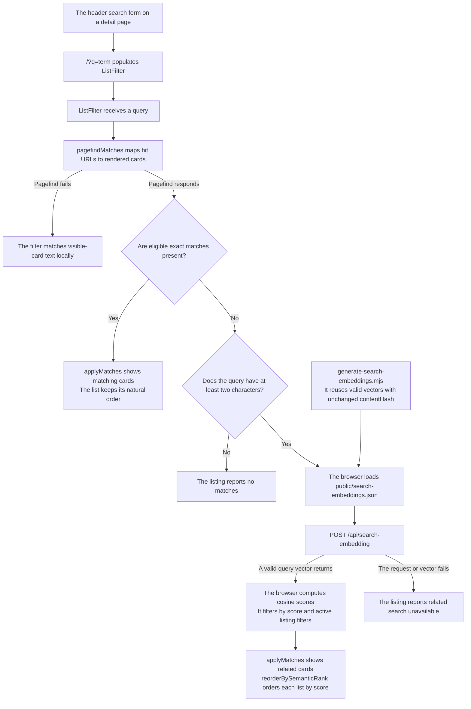
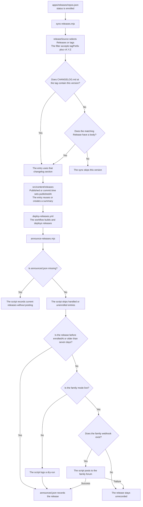
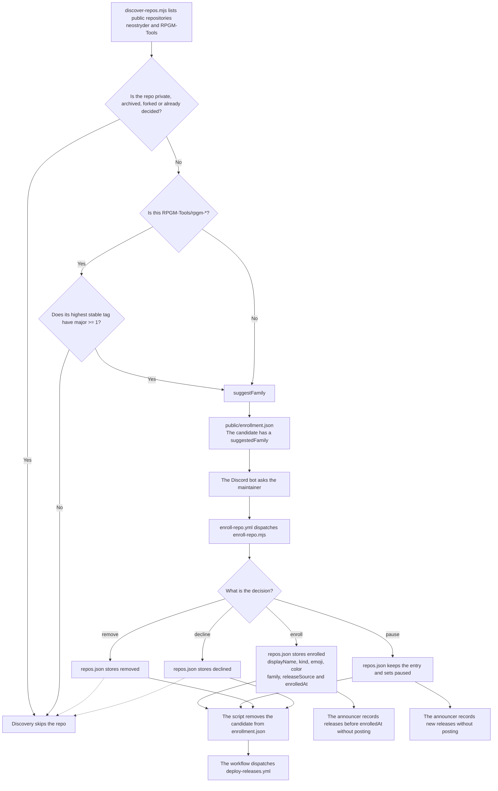
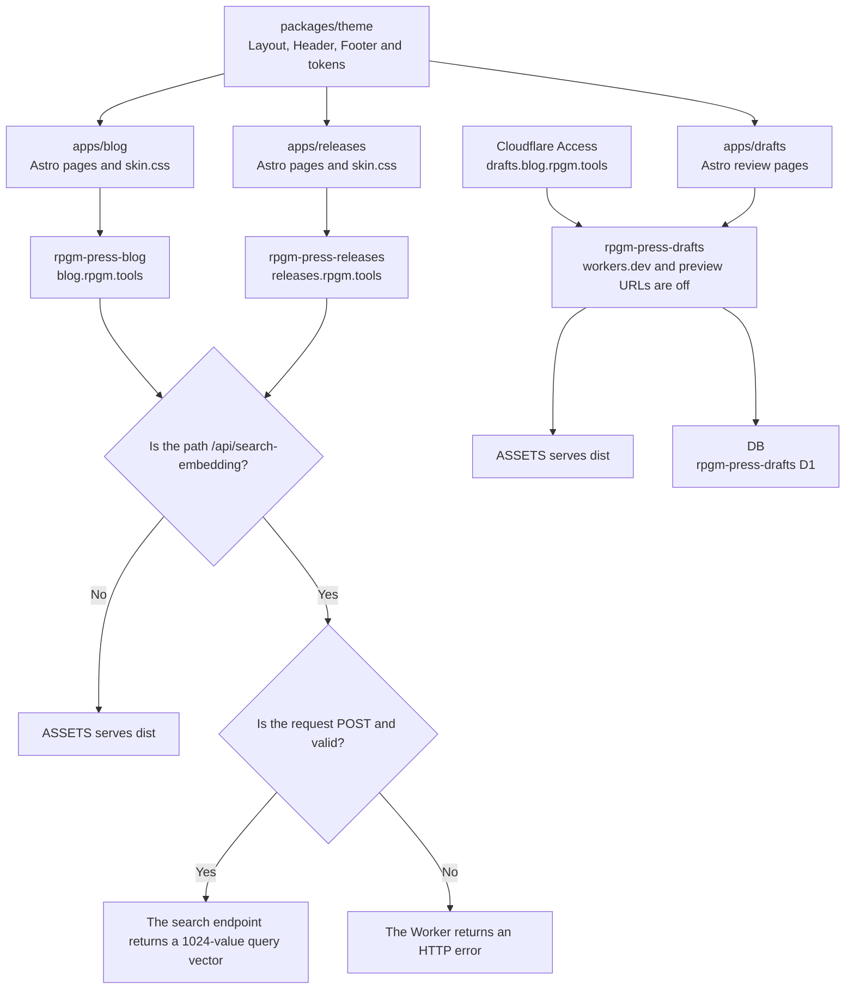
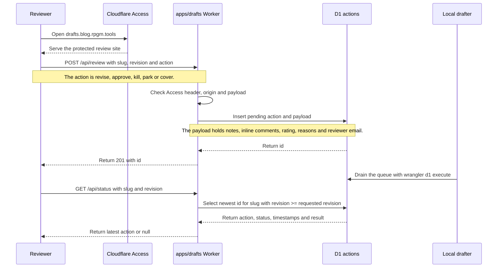

# RPGM Tools Press

A small publishing monorepo hosting two static sites and a private review app:

- **[apps/blog](apps/blog)** - "Relics & Reckonings", a personal dev blog at
  [blog.rpgm.tools](https://blog.rpgm.tools).
- **[apps/releases](apps/releases)** - an automated aggregator of release
  notes across the maintainer's repositories, at
  [releases.rpgm.tools](https://releases.rpgm.tools).
- **[apps/drafts](apps/drafts)** - the draft review queue, with its own Worker and D1
  database, behind Cloudflare Access.

Both sites are built with [Astro](https://astro.build) and deployed as
Cloudflare Workers serving static assets. They share one visual/component
system, [packages/theme](packages/theme), and each applies its own skin on
top of it.

## Development

```bash
pnpm install
pnpm --filter blog dev
pnpm --filter releases dev
```

## Comments

Both apps support GitHub Discussions-backed comments via
[giscus](https://giscus.app), gated behind a real Discussion category ID set
in each app's `src/consts.ts` (`GISCUS.categoryId`). A placeholder ID leaves
the widget unrendered rather than showing a broken embed.

## Search



*Source of truth: `ListFilter.astro`, `Header.astro`, and `apps/releases/src/worker.ts`. Semantic results are ranked within each list.*

Listing pages have one inline search field that filters the entries already
rendered in the body. Exact matches stay in reverse-chronological order; only the semantic fallback reorders results, best match first within each list.
Tier one uses [Pagefind](https://pagefind.app)'s plain JavaScript API and its
postbuild index (`astro build && pagefind --site dist`) to match full entry
text, then maps matching page URLs back to the existing cards/ledger rows.
Because that index only exists after postbuild, exercise full-text search
against a real build rather than `astro dev`.

Only when Pagefind finds no entry on the current listing does tier two run.
One normalized Qwen3 embedding per entry lives in each app's committed
`public/search-embeddings.json`; the browser sends the novel query text to
that site's `/api/search-embedding` Worker route, then ranks the in-scope
static vectors locally by cosine similarity. If Workers AI is unavailable,
the page stays usable and reports no related results. The stable header
search field (and `/` shortcut) focuses the local field when one exists or
navigates from a detail/About page to `/#entry-search`, so it never expands
or renders a separate results drawer.

Regenerate vectors after changing content with:

```bash
node .github/scripts/generate-search-embeddings.mjs all
```

The command requires `CLOUDFLARE_ACCOUNT_ID` plus either
`CLOUDFLARE_API_TOKEN` or a working `wrangler auth token` login, and reuses
vectors whose content hash is unchanged. CI runs the offline `--check` mode;
the releases sync regenerates and commits changed release vectors, while the
blog deploy refreshes its artifact before building.

## Theme

Light/dark/system, toggled from the header. Defaults to system - no
stored choice means an unvisited reader's OS preference decides, via
`prefers-color-scheme` in `tokens/base.css`. Clicking the toggle stores an
explicit `light`/`dark` choice in `localStorage` (`rpgm-theme`) that wins
over the OS setting from then on; a pre-paint inline script in `Layout`
applies a stored choice before first render so there's no flash of the
other theme. An app's own `skin.css` may override tokens per theme, but
each override must be gated to the same "is this theme actually active"
condition base.css itself uses (see the gated blocks in either app's
`skin.css`) - CSS layers ignore selector specificity, so an ungated
`:root` rule in the skin layer always wins regardless of which theme is
actually showing.

## Release notes sync



*Source of truth: `.github/scripts/sync-releases.mjs`, `.github/scripts/announce-releases.mjs`, and `apps/releases/repos.json`. The sync falls back to the GitHub Release body when the changelog section is missing.*

`.github/scripts/sync-releases.mjs` fills `apps/releases/src/content/releases` on a schedule and on push. It is not a live read at request time, so a new release can take up to the sync interval to appear. Only a strict `vX.Y.Z` tag is synced, after the repo's `tagPrefix` if it has one, and each repo's `releaseSource` says whether that list comes from its GitHub Releases or its tags. GitHub's own `prerelease` flag is not used as the filter, because it also marks every pre-1.0 version, and that history is real. The notes shown are that version's section of `CHANGELOG.md` at that tag. When that section is missing or empty, the sync uses the GitHub Release's body instead. The sync only reads the source repos. Sort order uses each entry's real publish or commit time rather than the changelog heading's date, so two releases on the same day still appear in the order they shipped.

Each entry in `apps/releases/repos.json` names a repo, its `family` (`neo-angband`, `rpgm-tools` or `other-projects`) and its `status`. Enrolled repos also carry a display name, `kind`, `emoji`, `color`, `releaseSource` and `enrolledAt`, plus an optional `tagPrefix` for version tags shaped like `thunderbird-v1.2.3`. Declined and removed repos stay in the file so discovery never offers them again. A repo's emoji and color mark it in the release list, on `/repos`, and in its Discord announcements. Each sync copies the emoji and color of every project the Stuff registry lists into `repos.json` through `sync-display.mjs`, so edit those two fields for a listed project in Stuff, not here. A project Stuff does not list keeps the values in the file. `/families/<family>` and `/rss/<family>.xml` list one family's releases.

A release-listing card's blurb comes from a short AI-synthesized summary of
that version's changelog section (MiniMax-M3.1-Flash, requires `MINIMAX_API_KEY`),
generated once when the entry is first synced and stored in its frontmatter
- a tag's content never changes, so later syncs reuse the stored summary
rather than paying for a fresh call. Without a key, or if a call fails, a
card falls back to a plain first-line truncation of the changelog instead.

## Enrollment and Discord announcements



*Source of truth: `.github/scripts/discover-repos.mjs`, `.github/scripts/enroll-repo.mjs`, `.github/scripts/sync-display.mjs`, and `.github/scripts/announce-releases.mjs`.*

Every sync also runs `discover-repos.mjs`. It lists the public repos in neostryder and RPGM-Tools, skips archived repos and forks, and writes the ones with no decision to `apps/releases/public/enrollment.json`, served at `/enrollment.json`, with a suggested family. An RPGM-Tools repo named `rpgm-*` only shows up once it reaches v1.0.0. The Discord bot asks about each candidate and dispatches `enroll-repo.yml` with the answer, which updates `repos.json` and rebuilds the site. Pausing keeps an enrolled repo on the Ledger without Discord announcements, and enrolling it again resumes them. Removing takes a repo off the Ledger and deletes its synced releases. `family` only matters when a repo is first enrolled or moved. The starter entry uses the family's default emoji and color until Stuff lists the project or `repos.json` is edited.

After each deploy, `announce-releases.mjs` posts new releases to the family's Discord forum through the `DISCORD_WEBHOOK_<FAMILY>` secret. It tags the thread with `DISCORD_<FAMILY>_RELEASE_TAG_ID` and mentions `DISCORD_<FAMILY>_ROLE_ID`, both repo variables. `apps/releases/announced.json` lists every release already handled. A release published before its repo's `enrolledAt`, more than seven days ago, or while the repo is paused is recorded without a post, and a family with no webhook is skipped until one is set. Neo Angband defaults to dry-run, which logs the post without sending it, until `DISCORD_NEO_ANGBAND_MODE` is `live`. The webhook's name, avatar and footer text come from `apps/releases/discord-families.json`.

## Structure



*Source of truth: `packages/theme`, each app's `wrangler.jsonc`, and the Worker in each app's `src/worker.ts`.*



*Source of truth: `apps/drafts/src/worker.ts` and `apps/drafts/schema.sql`. The local drafter writes to D1 directly, as the Worker header notes.*

```
packages/theme/    shared Astro components + design tokens (never forked per app)
apps/blog/          the personal blog
apps/releases/       the release-notes aggregator (content generated by
                     .github/scripts/sync-releases.mjs, do not hand-edit)
apps/drafts/         the draft review queue behind Cloudflare Access
```

## Branding

Each app has its own logo (`public/logo.webp`), shown in the header and as
the favicon, passed into `Layout`/`Header` via that app's `SITE_LOGO` const.
The footer's top row shows the site's own name plus its RSS feed and
source-repo links - never a "(c) Year <site name>" line, since a site's own
display name isn't a copyright holder. The actual copyright lives in its
own centered block below: a larger RPGM Tools emblem
(`public/rpgm-tools-logo.webp`, duplicated per app since each deploys its own
static assets) stacked above a "Copyright RPGM Tools, LLC" line, linking to
[rpgm.tools](https://rpgm.tools).

Blog posts carry one `category` (see `CATEGORY_META` in `apps/blog/src/consts.ts`)
shown as a solid-tinted chip ahead of their plain tag chips, both on post
cards and the post page itself - reusing that category's own color anywhere
it already carries an established identity (neo-angband reuses that repo's
own accent from `apps/releases/repos.json`) rather than inventing a new one.

See [AI_USAGE_POLICY.md](AI_USAGE_POLICY.md) for this project's AI use disclosure.
